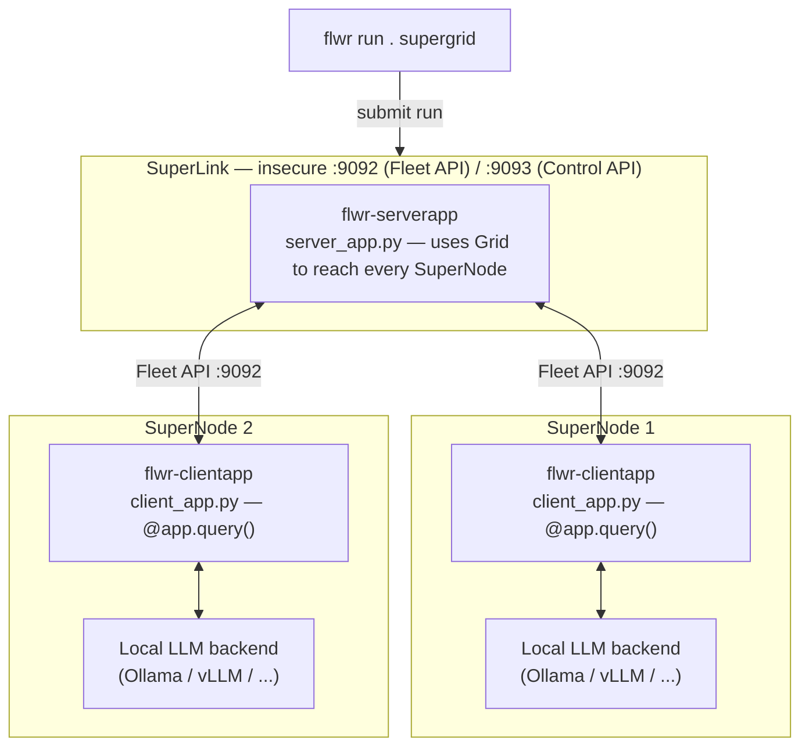
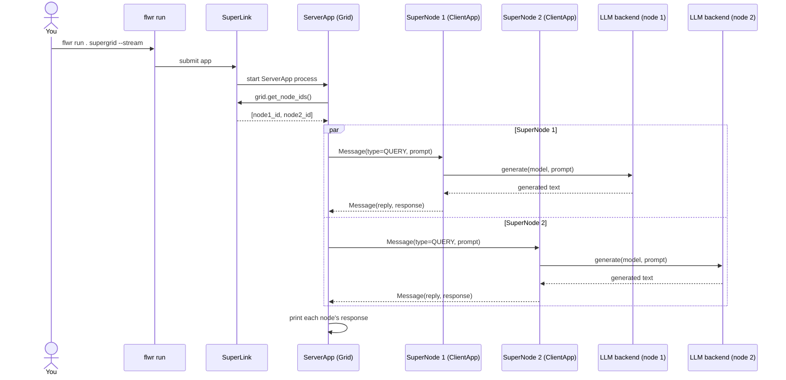

# inference_supergrid

Experiments with LLM inference on a [Flower](https://flower.ai) SuperGrid: one
SuperLink plus N SuperNodes. A `ServerApp` sends the same prompt to every
SuperNode; each SuperNode runs it through a **locally-served** LLM backend and
sends the response back. Only prompt/response text crosses the grid — no
weights, no data.

Each backend lives in its own folder with its own README, dependencies and
config. They share the same grid and message protocol.

| Folder | Backend | Docs |
|---|---|---|
| [ollama/](ollama/) | [Ollama](https://ollama.com) | [README](ollama/README.md), [TESTING](ollama/TESTING.md) |
| [vllm/](vllm/) | [vLLM](https://docs.vllm.ai) (OpenAI-compatible server) | [README](vllm/README.md) |

Tested with `flwr==1.23.0` (SuperLink/SuperNode deployment API).

## Architecture



Only the prompt goes out and the generated text comes back over the grid —
each SuperNode's model, and any local data, stays on that node. The only
backend-specific code is `client_app.py`; `server_app.py` is identical.

## Message flow



## Running the grid

Backend setup (installing the model server, pulling models, `pip install -e .`)
is described in each folder's README. The grid itself is started the same way
for every backend. From the backend folder, in separate terminals:

1. **SuperLink** (once, on the hub machine):

   ```bash
   flower-superlink --insecure
   ```

2. **SuperNode 1** (point `--superlink` at the SuperLink's Fleet API, port `9092`):

   ```bash
   flower-supernode --insecure \
     --superlink <superlink-host>:9092 \
     --clientappio-api-address 127.0.0.1:9094 \
     --node-config "partition-id=0"
   ```

3. **SuperNode 2**, on another machine or terminal. Each SuperNode needs its
   own `--clientappio-api-address`:

   ```bash
   flower-supernode --insecure \
     --superlink <superlink-host>:9092 \
     --clientappio-api-address 127.0.0.1:9095 \
     --node-config "partition-id=1"
   ```

4. **Run the app** against the `supergrid` federation defined in the folder's
   `pyproject.toml`:

   ```bash
   flwr run . supergrid --stream
   ```

   (On very new `flwr` releases the federation address may instead need to be
   defined in `~/.flwr/config.toml` — check `flwr run --help`.)

The ServerApp prints the connected SuperNode IDs, followed by each node's
response. Config such as `prompt` and `model` lives in
`[tool.flwr.app.config]` in each `pyproject.toml` and can be overridden with
`--run-config`; the available keys are listed in each folder's README.
