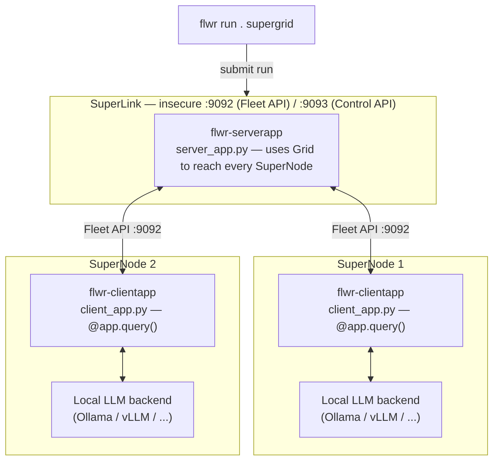
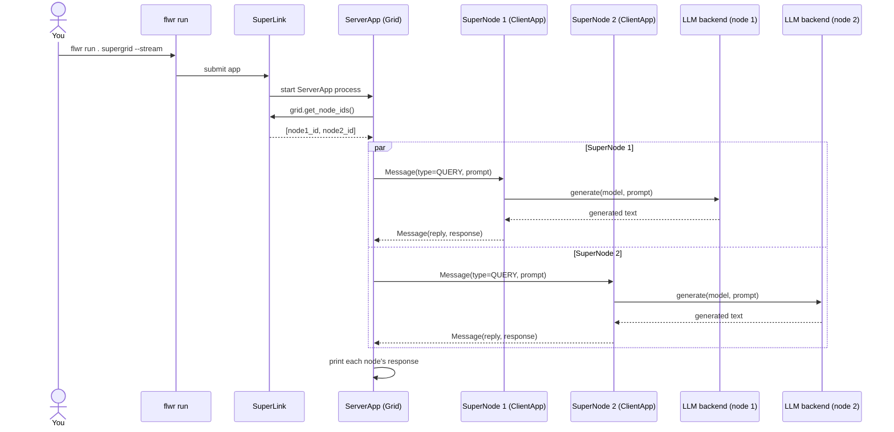

# Distributed AI Inference using Flower Superlink

Experiments with LLM inference on a [Flower](https://flower.ai) SuperLink: one
SuperLink plus N SuperNodes. A `ServerApp` sends the same prompt to every
SuperNode; each SuperNode runs it through a **locally-served** LLM backend and
sends the response back. Only prompt/response text crosses the grid — no
weights, no data.

Each backend lives in its own folder with its own README, dependencies and
config. They share the same grid and message protocol.

| Folder | Backend | Docs |
|---|---|---|
| [ollama/](ollama/) | [Ollama](https://ollama.com) | [README](ollama/README.md) |
| [vllm/](vllm/) | [vLLM](https://docs.vllm.ai) (OpenAI-compatible server) | [README](vllm/README.md) |

Tested with `flwr==1.23.0` (SuperLink/SuperNode deployment API).

## Architecture



Only the prompt goes out and the generated text comes back over the grid —
each SuperNode's model, and any local data, stays on that node. The only
backend-specific code is `client_app.py`; `server_app.py` is identical.

## Message flow



## Install

Requires Python 3.10-3.12 and [`uv`](https://docs.astral.sh/uv/) (`brew install uv`).
Create one virtual environment at the repo root, **not** inside `ollama/` or
`vllm/`: `flwr run` bundles the app folder and uploads it, so a venv inside it
bloats the bundle.

```bash
uv venv --python 3.12 .venv
source .venv/bin/activate
uv pip install "flwr>=1.13,<1.24"     # provides flower-superlink, flower-supernode, flwr
```

Each backend then installs its own app and model server on the SuperNode
machines; see [ollama/README.md](ollama/README.md) and [vllm/README.md](vllm/README.md).

## Quick test: join nodes to the grid

This checks the grid itself (SuperLink + 2 SuperNodes) before any LLM backend
is involved. Use one terminal per command, each with the venv activated.

1. **SuperLink** (once, on the hub machine). Fleet API on `:9092`, Control API on `:9093`:

   ```bash
   flower-superlink --insecure
   ```

2. **SuperNode 1**. Point `--superlink` at the SuperLink's Fleet API
   (`127.0.0.1` if everything runs on one machine):

   ```bash
   flower-supernode --insecure \
     --superlink <superlink-host>:9092 \
     --clientappio-api-address 127.0.0.1:9094 \
     --node-config "partition-id=0"
   ```

3. **SuperNode 2**, on another machine or terminal. Each SuperNode on the same
   machine needs its own `--clientappio-api-address`:

   ```bash
   flower-supernode --insecure \
     --superlink <superlink-host>:9092 \
     --clientappio-api-address 127.0.0.1:9095 \
     --node-config "partition-id=1"
   ```

4. **Check the nodes joined.** Both SuperNodes should log that they connected
   to the SuperLink. You can also list them from the SuperLink's federation:

   ```bash
   flwr supernode list ollama supergrid   # or: flwr supernode list vllm supergrid
   ```

If a node doesn't show up, check the `--superlink` address, that port `9092`
is reachable, and that each SuperNode has a unique `--clientappio-api-address`.
The grid stays up for both examples below; you don't need to restart it to
switch backend.

## Understanding `pyproject.toml`

Flower uses the .toml file as the main template and workflow definition. Each example backend (ollama/vllm) folder has a `pyproject.toml` that is both the Python package definition and the Flower app definition. The Flower parts live under
`[tool.flwr.*]`:

```toml
[tool.flwr.app.components]            # WHAT runs
serverapp = "supergrid_llm.server_app:app"
clientapp = "supergrid_llm.client_app:app"

[tool.flwr.app.config]                # WHAT it is told (per run)
model = "llama3.2:latest"
prompt = "In one sentence, what is federated learning?"

[tool.flwr.federations]               # WHERE `flwr run` sends it
default = "supergrid"

[tool.flwr.federations.supergrid]
address = "127.0.0.1:9093"
insecure = true
```

| Section | Defines | Used by |
|---|---|---|
| `[tool.flwr.app.components]` | Which Python objects are the `ServerApp` and `ClientApp` (`module:variable`). | The SuperLink starts the `serverapp`; each SuperNode starts the `clientapp`. |
| `[tool.flwr.app.config]` | Run config: prompt, model and any backend setting. Read in code as `context.run_config["prompt"]`. Override per run with `--run-config 'prompt="..."'`. | Both apps. |
| `[tool.flwr.federations.<name>]` | The SuperLink's **Control API** address that `flwr run . <name>` submits to (`9093` by default), and `insecure = true` for no TLS. | The `flwr run` CLI only. |
| `[project]` / `dependencies` | Python package name and dependencies (`flwr`, plus `ollama` or `openai`). | `uv pip install -e .` |

Each folder's README lists the exact keys, defaults and backend-specific
settings for that case: [ollama/README.md](ollama/README.md#config) and
[vllm/README.md](vllm/README.md#config).

## Run an example

With the grid running, follow the backend README, which covers installing the
model server and the app on each SuperNode, then runs the app from its folder:

| Backend | Setup and run |
|---|---|
| Ollama | [ollama/README.md](ollama/README.md) |
| vLLM | [vllm/README.md](vllm/README.md) |

In both cases the final step is, from the backend folder:

```bash
flwr run . supergrid --stream
```

The ServerApp prints the connected SuperNode IDs, followed by each node's
response. The `supergrid` federation (SuperLink Control API address) is defined
in each folder's `pyproject.toml`. Config such as `prompt` and `model` lives in
`[tool.flwr.app.config]` there and can be overridden with `--run-config`; the
keys are listed in each folder's README. On very new `flwr` releases the
federation address may instead need to be defined in `~/.flwr/config.toml`;
check `flwr run --help`.
