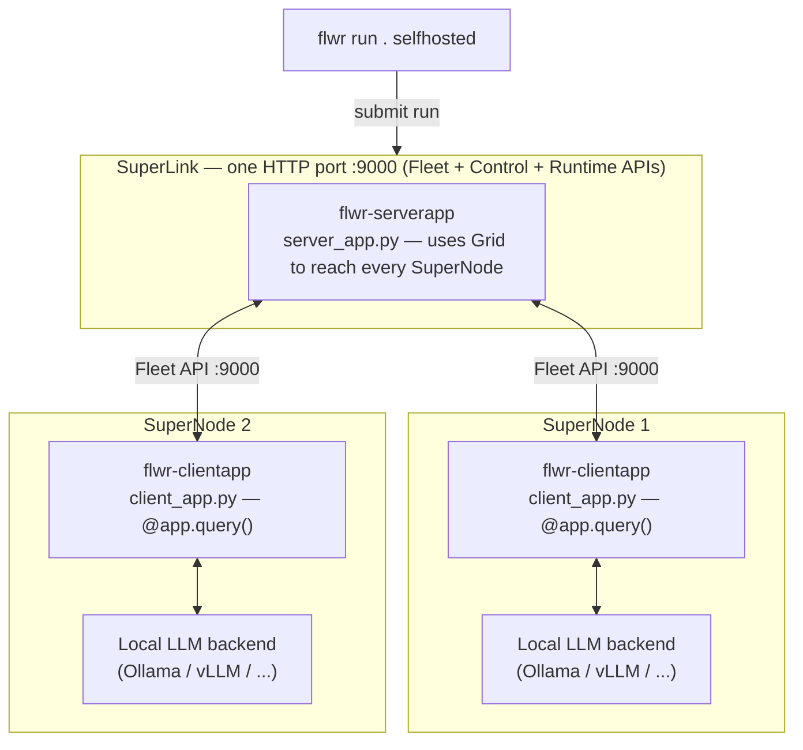

# Distributed AI Inference using Flower Superlink

Experiments with LLM inference on a [Flower](https://flower.ai) SuperLink: one
SuperLink plus N SuperNodes. A `ServerApp` sends the same prompt to every
SuperNode; each SuperNode runs it through a **locally-served** LLM backend and
sends the response back. Only prompt/response text crosses the grid — no
weights, no data.

Each backend lives in its own folder with its own README, dependencies and
config. They share the same grid and message protocol.

| Folder | Backend | Docs |
|---|---|---|
| [ollama/](ollama/) | [Ollama](https://ollama.com) | [README](ollama/README.md) |
| [vllm/](vllm/) | [vLLM](https://docs.vllm.ai) (OpenAI-compatible server) | [README](vllm/README.md) |

Tested with `flwr==1.40.0` (SuperLink/SuperNode deployment API).

## Architecture



Only the prompt goes out and the generated text comes back over the grid —
each SuperNode's model, and any local data, stays on that node. The only
backend-specific code is `client_app.py`; `server_app.py` is identical.

## Message flow


## Examples

The examples are self-contained. Each folder has its own README, its own
`requirements.txt`, its own virtual environment (`ollama_env`, `vllm_env`), and a
quick test to bring up the grid. Start with the one you want and follow its README.

## Understanding `pyproject.toml`

Flower uses the .toml file as the main template and workflow definition. Each example backend (ollama/vllm) folder has a `pyproject.toml` that is both the Python package definition and the Flower app definition. The Flower parts live under
`[tool.flwr.*]`:

```toml
[tool.flwr.app.components]            # WHAT runs
serverapp = "supergrid_llm.server_app:app"
clientapp = "supergrid_llm.client_app:app"

[tool.flwr.app.config]                # WHAT it is told (per run)
model = "llama3.2:latest"
prompt = "In one sentence, what is federated learning?"
```

The SuperLink address is not in this file. It is defined as a named
`[superlink.<name>]` connection in `~/.flwr/config.toml` (see the quick test in each folder's README)
and selected with `flwr run . <name>`.

| Section | Defines | Used by |
|---|---|---|
| `[tool.flwr.app.components]` | Which Python objects are the `ServerApp` and `ClientApp` (`module:variable`). | The SuperLink starts the `serverapp`; each SuperNode starts the `clientapp`. |
| `[tool.flwr.app.config]` | Run config: prompt, model and any backend setting. Read in code as `context.run_config["prompt"]`. Override per run with `--run-config 'prompt="..."'`. | Both apps. |
| `[project]` / `dependencies` | Python package name and dependencies (`flwr`, plus `ollama` or `openai`) and the minimum Python version. | `uv pip install -e .` |

**Why one per example, but a single venv?** Flower treats a folder as one app:
`flwr run .` reads that folder's `pyproject.toml` to find the `ServerApp` and
`ClientApp` and the run config, and bundles the folder to send it to the
grid. The two backends have different entry points (`supergrid_llm` vs
`supergrid_vllm`), different config keys and different client libraries, and
one `pyproject.toml` cannot define two apps, so each example needs its own.
Each example also gets its own virtual environment, so the examples stay
independent (and vLLM's heavy dependencies never touch the Ollama one).

Each folder's README lists the exact keys, defaults and backend-specific
settings for that case: [ollama/README.md](ollama/README.md#config) and
[vllm/README.md](vllm/README.md#config).
