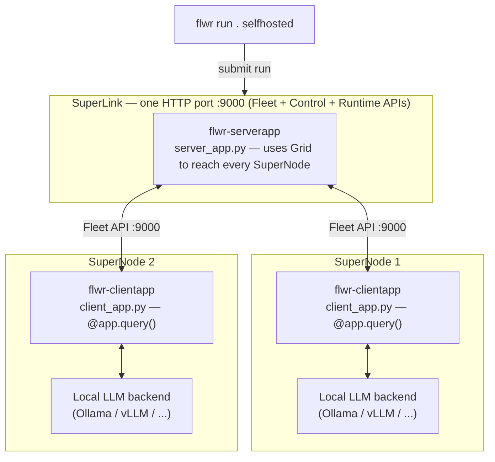

# Distributed AI Inference using Flower Superlink

Experiments with LLM inference on a [Flower](https://flower.ai) SuperLink: one
SuperLink plus N SuperNodes. A `ServerApp` sends the same prompt to every
SuperNode; each SuperNode runs it through a **locally-served** LLM backend and
sends the response back. Only prompt/response text crosses the grid — no
weights, no data.

Each backend lives in its own folder with its own README, dependencies and
config. They share the same grid and message protocol.

| Folder | Backend | Docs |
|---|---|---|
| [ollama/](ollama/) | [Ollama](https://ollama.com) | [README](ollama/README.md) |
| [vllm/](vllm/) | [vLLM](https://docs.vllm.ai) (OpenAI-compatible server) | [README](vllm/README.md) |

Tested with `flwr==1.40.0` (SuperLink/SuperNode deployment API).

## Architecture



Only the prompt goes out and the generated text comes back over the grid —
each SuperNode's model, and any local data, stays on that node. The only
backend-specific code is `client_app.py`; `server_app.py` is identical.

## Message flow


## Install

Requires Python 3.11+ and [`uv`](https://docs.astral.sh/uv/) (`brew install uv`).
Create one virtual environment at the repo root, **not** inside `ollama/` or
`vllm/`: `flwr run` bundles the app folder and uploads it, so a venv inside it
bloats the bundle.

```bash
uv venv --python 3.12 .venv
source .venv/bin/activate
uv pip install -r requirements.txt   # flwr (SuperLink, SuperNode, CLI) + ollama and openai clients
```

`requirements.txt` lists the dependencies of all the examples, so this single
venv runs any of them. On a SuperNode machine that only runs one backend you
can install just `flwr` and that backend's client instead.

**Keep the venv activated** in every terminal that runs Flower commands. The
SuperLink and SuperNodes launch helper processes (such as `flower-superexec`)
by name, and fail with `No such file or directory: 'flower-superexec'` if the
venv's `bin/` is not on `PATH`.

Check the install with `flwr --version` (expect 1.40.x).

### Model servers: install outside this venv

The model servers (Ollama, vLLM) are not Python dependencies of the app. Each
runs as its own process, and the app only reaches it over HTTP, so they are not
in `requirements.txt` and should not go in this venv. They must be installed on
**every** SuperNode machine, and when you run everything on one machine (as in
this README) you install them there first, before running an example:

- **Ollama:** a system app (`brew install ollama` or the installer from
  [ollama.com](https://ollama.com)), not a pip package.
- **vLLM:** Linux only, large, and pins its own torch/CUDA versions, so give it
  its own venv (see [vllm/README.md](vllm/README.md#setup)).

Each backend then installs its own app and model server on the SuperNode
machines; see [ollama/README.md](ollama/README.md) and [vllm/README.md](vllm/README.md).

## Quick test: join nodes to the grid

This checks the grid itself (SuperLink + 2 SuperNodes) before any LLM backend
is involved. Use one terminal per command, each with the venv activated.

1. **SuperLink** (once, on the hub machine). It serves the
   Fleet, Control and Runtime APIs together on a single HTTP port. Its default,
   `8000`, is also vLLM's default, so use another port (`9000` here):

   ```bash
   flower-superlink --insecure --port 9000
   ```

   For SuperNodes on other machines, also bind it to a reachable address with
   `--host` (see `flower-superlink --help`).

2. **SuperNode 1**. Point `--superlink` at the SuperLink (`127.0.0.1:9000` if
   everything runs on one machine). `--port` is this SuperNode's own local
   API port (default `9094`):

   ```bash
   flower-supernode --insecure \
     --superlink <superlink-host>:9000 \
     --port 9094 \
     --node-config "partition-id=0"
   ```

3. **SuperNode 2**, on another machine or terminal. SuperNodes on the same
   machine need different `--port` values:

   ```bash
   flower-supernode --insecure \
     --superlink <superlink-host>:9000 \
     --port 9095 \
     --node-config "partition-id=1"
   ```

4. **Register the SuperLink for the CLI.** `flwr run` and `flwr supernode list`
   find the SuperLink through a named *connection* in `~/.flwr/config.toml`
   (created on first use). Add one for your SuperLink. The built-in `supergrid`
   connection is Flower's hosted service, so use a different name:

   ```toml
   [superlink.selfhosted]
   address = "127.0.0.1:9000"
   insecure = true
   ```

   Check it with `flwr config ls`.

5. **Check the nodes joined.** Both SuperNodes should log a `SuperNode ID`.
   List them from the SuperLink. On a separate terminal run: 

   ```bash
   flwr supernode list selfhosted
   ```

   Both should show `online`. You should get something like:

Using SuperLink: selfhosted (127.0.0.1:9000)
📄 Listing all nodes...
┏━━━━━━━━━━━━━━━━━━━━━┳━━━━━━━┳━━━━━━━━┳━━━━━━━━━┳━━━━━━━━━━━━━━━━━━━━━━┓
┃       Node ID       ┃ Owner ┃ Status ┃ Elapsed ┃   Status Changed @   ┃
┡━━━━━━━━━━━━━━━━━━━━━╇━━━━━━━╇━━━━━━━━╇━━━━━━━━━╇━━━━━━━━━━━━━━━━━━━━━━┩
│ 6032684002794125263 │ none  │ online │ 3m 33s  │ 2026-10-20 16:43:07Z │
├─────────────────────┼───────┼────────┼─────────┼──────────────────────┤
│ 9622216904661572043 │ none  │ online │ 78s     │ 2026-10-20 16:45:22Z │
└─────────────────────┴───────┴────────┴─────────┴──────────────────────┘

If a node doesn't show up, check the `--superlink` address, that port `9000`
is reachable, and that SuperNodes on the same machine have unique `--port` values.
The grid stays up for both examples below; you don't need to restart it to
switch backend.

---

## Understanding `pyproject.toml`

Flower uses the .toml file as the main template and workflow definition. Each example backend (ollama/vllm) folder has a `pyproject.toml` that is both the Python package definition and the Flower app definition. The Flower parts live under
`[tool.flwr.*]`:

```toml
[tool.flwr.app.components]            # WHAT runs
serverapp = "supergrid_llm.server_app:app"
clientapp = "supergrid_llm.client_app:app"

[tool.flwr.app.config]                # WHAT it is told (per run)
model = "llama3.2:latest"
prompt = "In one sentence, what is federated learning?"
```

The SuperLink address is not in this file. It is defined as a named
`[superlink.<name>]` connection in `~/.flwr/config.toml` (see the quick test)
and selected with `flwr run . <name>`.

| Section | Defines | Used by |
|---|---|---|
| `[tool.flwr.app.components]` | Which Python objects are the `ServerApp` and `ClientApp` (`module:variable`). | The SuperLink starts the `serverapp`; each SuperNode starts the `clientapp`. |
| `[tool.flwr.app.config]` | Run config: prompt, model and any backend setting. Read in code as `context.run_config["prompt"]`. Override per run with `--run-config 'prompt="..."'`. | Both apps. |
| `[project]` / `dependencies` | Python package name and dependencies (`flwr`, plus `ollama` or `openai`) and the minimum Python version. | `uv pip install -e .` |

**Why one per example, but a single venv?** Flower treats a folder as one app:
`flwr run .` reads that folder's `pyproject.toml` to find the `ServerApp` and
`ClientApp` and the run config, and bundles the folder to send it to the
grid. The two backends have different entry points (`supergrid_llm` vs
`supergrid_vllm`), different config keys and different client libraries, and
one `pyproject.toml` cannot define two apps, so each example needs its own. The
virtual environment is a separate matter: it only holds installed packages, so
one at the repo root (from `requirements.txt`) serves every example.

Each folder's README lists the exact keys, defaults and backend-specific
settings for that case: [ollama/README.md](ollama/README.md#config) and
[vllm/README.md](vllm/README.md#config).

## Run an example

With the grid running, follow the backend README, which covers installing the
model server and the app on each SuperNode, then runs the app from its folder:

| Backend | Setup and run |
|---|---|
| Ollama | [ollama/README.md](ollama/README.md) |
| vLLM | [vllm/README.md](vllm/README.md) |

In both cases the final step is, from the backend folder, with the connection
registered in the quick test:

```bash
flwr run . selfhosted --stream
```

The ServerApp prints the connected SuperNode IDs, followed by each node's
response. Config such as `prompt` and `model` lives in
`[tool.flwr.app.config]` in the folder's `pyproject.toml` and can be overridden
with `--run-config`; the keys are listed in each folder's README.
