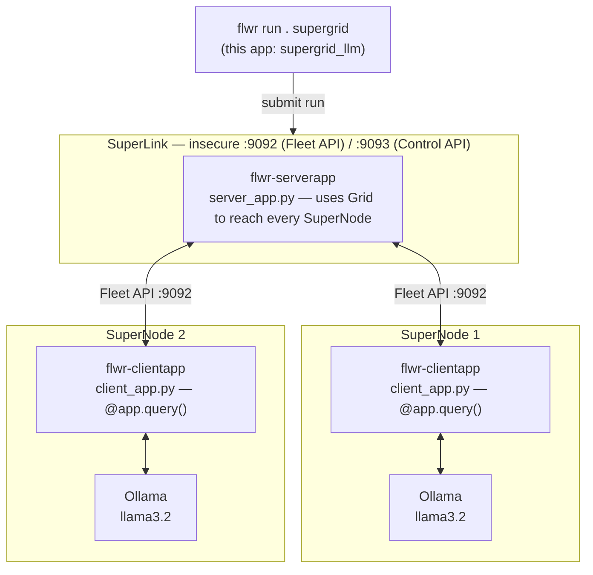
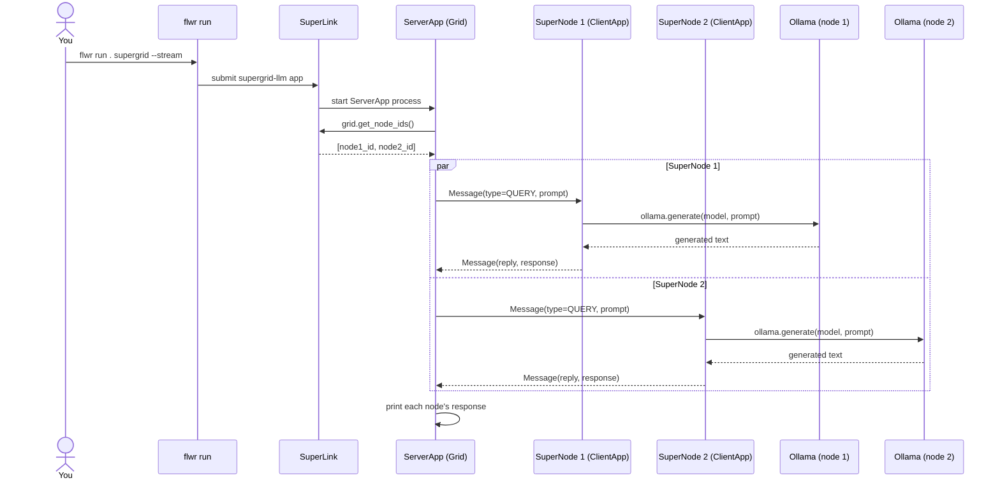

# SuperGrid LLM example

Minimal example of running an LLM across a Flower "SuperGrid": one SuperLink
plus 2 SuperNodes. The ServerApp sends the same prompt to both SuperNodes;
each SuperNode runs the prompt through a locally-served Ollama model and
sends the response back. Nothing but prompt/response text ever crosses the
grid — no weights, no data.

This uses Flower's modern SuperLink/SuperNode deployment API (tested with
`flwr==1.23.0`), which is a different runtime from the older
`fl.server.start_server` / `NumPyClient` pattern used in
[`src/client.py`](../client.py) and [`src/server.py`](../server.py).

## Architecture



Only the prompt goes out and the generated text comes back over the grid —
each SuperNode's Ollama model, and any local data, stays on that node.

## Message flow



## Prerequisites

On **every** machine that will run a SuperNode:

```bash
ollama pull llama3.2:latest
ollama serve   # if not already running as a service
```

From this directory:

```bash
pip install -e .
```

## Run it

1. Start the SuperLink (once, on whichever machine is the hub):

   ```bash
   flower-superlink --insecure
   ```

2. Start SuperNode 1 (point `--superlink` at the SuperLink's Fleet API
   address, port `9092` by default):

   ```bash
   flower-supernode --insecure \
     --superlink <superlink-host>:9092 \
     --clientappio-api-address 127.0.0.1:9094 \
     --node-config "partition-id=0"
   ```

3. Start SuperNode 2, on a second machine or a second terminal on the same
   machine. Each SuperNode needs its own `--clientappio-api-address`:

   ```bash
   flower-supernode --insecure \
     --superlink <superlink-host>:9092 \
     --clientappio-api-address 127.0.0.1:9095 \
     --node-config "partition-id=1"
   ```

4. From this directory, run the app against the `supergrid` federation
   defined in `pyproject.toml`:

   ```bash
   flwr run . supergrid --stream
   ```

   (On very new `flwr` releases the federation address may instead need to
   be defined in `~/.flwr/config.toml` — check `flwr run --help` if the
   command above is rejected.)

You should see the ServerApp print the connected SuperNode IDs, followed by
each node's generated response to the shared prompt.

## Customize

Edit `[tool.flwr.app.config]` in `pyproject.toml`, or override at the
command line, e.g.:

```bash
flwr run . supergrid --run-config 'prompt="Explain SuperGrid in one line" model="llama3.2:latest"'
```
